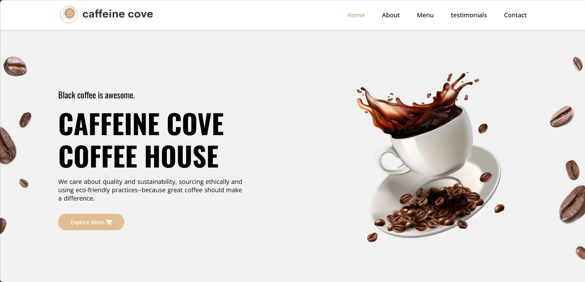

# ☕ Caffeine Cove – Coffee House Website

A responsive landing page for a coffee shop, built with **HTML, CSS and vanilla JavaScript**.
This is a practice project to apply what I learned about layout, responsive design and DOM manipulation.

🔗 **Live demo:** [View the website](https://mustapha-aa.github.io/Projects-Web-HTML-CSS-JavaScript/Coffee-House-Landing-Page/)



## ✨ Features

- Fixed header with smooth-scroll navigation
- Active nav link that follows the section currently in view (`IntersectionObserver`)
- Mobile menu with a toggle button (hamburger / close icon)
- Fully responsive layout (desktop, tablet, mobile) using media queries
- Sections: Home, About, Menu, Testimonials, Contact
- Table booking form with embedded Google Map
- Footer with contact info, social links and quick links

## 🛠️ Built With

- **HTML5**: semantic structure
- **CSS3**: Flexbox, `:where()`, media queries, custom styling
- **JavaScript (ES6)**: DOM manipulation and `IntersectionObserver`
- [Font Awesome](https://fontawesome.com/) for icons
- [Google Fonts](https://fonts.google.com/) (Open Sans, Oswald)

## 📁 Project Structure

```
Coffee-House-Landing-Page/
├── index.html
├── style.css
├── main.js
└── images/
    ├── logo.png
    ├── home-bg.png
    ├── footer-bg.png
    ├── coffee-home.png
    ├── about-img.png
    ├── menu-1.png … menu-8.png
    └── person1.jpg … person3.jpg
```

## 🚀 Getting Started

1. Clone the repository.
2. Open the folder and double-click `index.html`
   (or use the **Live Server** extension in VS Code).

No installation or build step is needed.

## 🌐 Deployment

The site can be hosted for free with **GitHub Pages**:
`Settings → Pages → Branch: main → Save`.

## 📚 What I Learned

- Building a layout with Flexbox and making it responsive
- Structuring CSS with reusable utility classes
- Creating a mobile navigation menu with JavaScript
- Highlighting the active section while scrolling

## 🔮 Possible Improvements

- Make the booking form send data to a backend or a service
- Add a menu filter by category
- Add animations on scroll

## 👤 Author

**mustapha-aa**: [GitHub](https://github.com/mustapha-aa)

---

⭐ If you like this project, feel free to give it a star!
