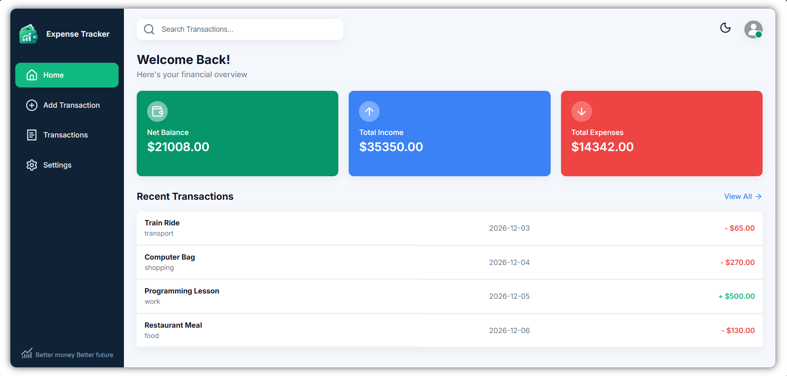

# Expense Tracker

A simple and modern Expense Tracker built with **HTML, CSS, and JavaScript**. This application helps users manage their personal finances by tracking income and expenses, organizing transactions, and monitoring their financial balance.

## Preview

🔗 **Live demo:** [View the website](https://mustapha-aa.github.io/Projects-Web-HTML-CSS-JavaScript/Expense-Tracker/)



## Features

- **Dashboard:** View your net balance, total income, and total expenses.
- **Add Transactions:** Add new income and expense transactions.
- **Edit Transactions:** Update existing transaction details.
- **Delete Transactions:** Remove transactions you no longer need.
- **Search Transactions:** Find transactions by name.
- **Filter Transactions:** Filter transactions by type and category.
- **Recent Transactions:** Display the latest transactions on the dashboard.
- **Dark Mode:** Switch between light and dark themes.
- **General Settings:** Customize language, currency, and balance visibility.
- **Data Management:** Export, import, and reset transaction data.
- **Profile Page:** Manage personal information and view account statistics.
- **Local Storage:** Save transaction data in the browser.

## Technologies Used

- HTML5
- CSS3
- JavaScript
- Local Storage
- Lucide Icons

## Project Structure

```text
Expense-Tracker/
├── images/
│   ├── logo.png
│   └── user-img.png
├── index.html
├── README.md
├── screenshot.png
├── script.js
└── style.css
```

## Getting Started

1. Clone this repository:

2. Open the project folder.

3. Open `index.html` in your browser.

No installation or additional dependencies are required.

## Data Storage

This project uses the browser's **Local Storage** to save transaction data and user preferences.

Your data remains available in the same browser unless the local storage is cleared.

## Future Improvements

- Add interactive charts and financial reports.
- Improve transaction management.
- Add more filtering and sorting options.
- Support additional currencies.
- Improve responsive design for mobile devices.

## 👨‍💻 Author

Created as part of my journey in learning Front-End Web Development.

- GitHub: [Your GitHub Profile](https://github.com/mustapha-aa)

---

**If you like this project, feel free to give it a ⭐ on GitHub!**
