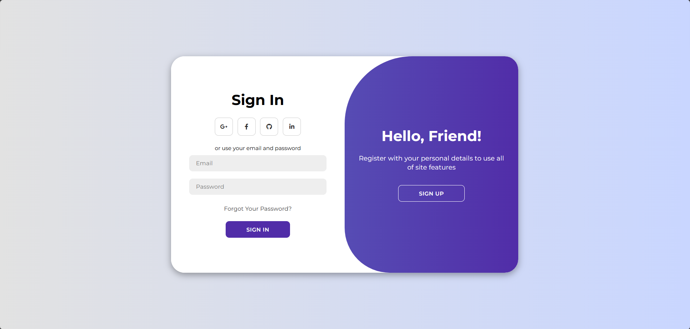

# Login & Register Form

A responsive-style animated **Sign In / Sign Up** form with a sliding panel effect, built with plain HTML, CSS, and JavaScript.

> 📚 This is a learning project to practice what I've learned. It is a front-end UI only, with no backend or real authentication.

## Live Demo

[View the demo](https://mustapha-aa.github.io/Projects-Web-HTML-CSS-JavaScript/Login-Registration-System/)


## Preview




## Features

- Smooth sliding animation between the Sign In and Sign Up panels
- Social login icons (Font Awesome)
- Clean, modern design using the Montserrat font
- No frameworks or dependencies, just HTML, CSS, and vanilla JS

## Built With

- HTML5
- CSS3 (Flexbox, transitions, keyframe animations)
- JavaScript (DOM manipulation)
- [Font Awesome](https://fontawesome.com/) for icons
- [Google Fonts](https://fonts.google.com/) (Montserrat)

## Project Structure

```
sliding-login-form/
├── index.html
├── style.css
├── script.js
└── README.md
```

## Getting Started

1. Clone the repository:
2. Open the project folder.
3. Open `index.html` in your browser.

No installation or build step is required.

## How It Works

`script.js` toggles an `active` class on the main container when the "Sign In" or "Sign Up" button in the side panel is clicked. The CSS transitions and transforms handle the sliding and fading animation.

## Credits

Based on a tutorial / design I followed while learning. **mustapha-aa**: [GitHub](https://github.com/mustapha-aa)

## License

This project is open source and free to use for learning purposes.
